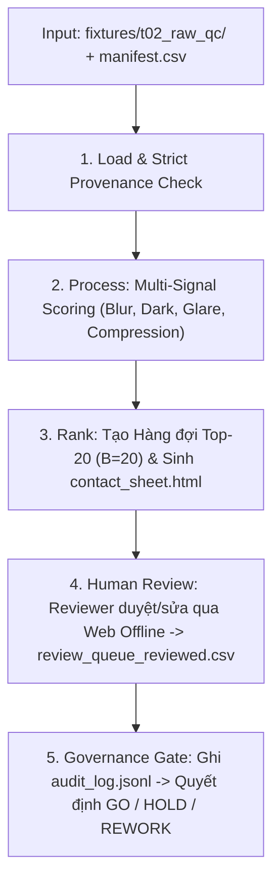

# Group Report — Day 06 Data Lab (Field-to-Release PoC)

> Báo cáo chính thức của Nhóm G02 — Thử thách T02: Raw QC Triage.
> Mọi số liệu được trích xuất trực tiếp từ các file thực nghiệm do hệ thống sinh ra (`out/poc/run_info.json`, `out/poc/decision.json`, `tests/test_t02_qa.py`, `src/t02/scoring.py`).

---

## 00 · Header

| Mục | Giá trị |
|---|---|
| **Group ID** | **G02** |
| **Challenge** | **T02 · Raw QC Triage: Ảnh mờ, lóa, thiếu sáng và nén vỡ** |
| **Thành viên & Vai trò** | 1. Pham Hai (Lead / Integrator) · 2. Bui Van Binh (Data & Baseline) · 3. Loversky02 (Core Algorithm) · 4. Thao Linh (QA / Metric & Test Lead) · 5. Hoang / Team (Human Review & Report) |
| **Git URL** | `https://github.com/PHai237/K5-DAY06-L2-Ours-DataGovernanceAndPrivacy` |
| **Tag `demo-180m` (commit)** | `4fa806e` |
| **Tag `final-24h` (commit)** | *(Pending release tag)* |
| **Deadline (giờ VN)** | 2026-11-15 18:00 (giờ VN) |

---

## 01 · Problem statement

- **Ai bị ảnh hưởng / chịu hậu quả khi hệ thống sai?**
  - **Mô hình AI tự hành downstream**: Nếu ảnh chất lượng kém (mờ chuyển động, lóa biển số, tối đen không nhận dạng được vật cản, hoặc nén JPEG gây méo biên) lọt vào tập huấn luyện, mô hình xe tự hành sẽ học sai đặc trưng (false detection, missed obstacle) dẫn đến tai nạn giao thông nghiêm trọng.
  - **Đội ngũ Vận hành & Chuyên viên dán nhãn (Annotation Team)**: Nếu ảnh lỗi không được phát hiện từ khâu thô (Field), chi phí dán nhãn bị lãng phí hoàn toàn và làm chậm tiến độ dự án.
- **Điểm nghẽn cụ thể**:
  - Không thể dùng con người duyệt thủ công toàn bộ 100% dữ liệu thu thập (chi phí quá lớn).
  - Ngân sách review bị giới hạn nghiêm ngặt: chuyên viên chỉ có thể kiểm tra tối đa **$B = 20$ ảnh** cho mỗi lô dữ liệu. Do đó, hệ thống phải xếp hạng cực kỳ chính xác để 20 ảnh được kiểm tra chứa nhiều lỗi thật nhất.
- **Đầu vào $\rightarrow$ Đầu ra**:
  - *Đầu vào*: Thư mục ảnh thô kèm metadata `images.csv` (96 ảnh, kích thước $320 \times 180$, camera A/B, điều kiện ngày/hoàng hôn/đêm) và `manifest.csv`.
  - *Đầu ra*: `ranked_review.csv` (xếp hạng 96 ảnh theo điểm số nghi lỗi giảm dần), `review_queue.csv` (top-20 ảnh ưu tiên), `contact_sheet.html` (giao diện offline để reviewer duyệt), `audit_log.jsonl` (nhật ký kiểm toán bất biến), và `decision.json` (quyết định GO / HOLD / REWORK).
- **Tiêu chí GO / HOLD / REWORK (Risk Gate)**:
  - **`HOLD`**: Khi lô dữ liệu chưa hoàn thành quy trình review ($< 20$ quyết định), hoặc có ảnh bị đánh dấu `escalate` (cần chuyên gia cấp cao thẩm định) hoặc `skip`.
  - **`REWORK`**: Khi quy trình review đã hoàn tất và phát hiện ít nhất một ảnh lỗi nghiêm trọng yêu cầu chụp lại (`RECAPTURE`). Lô dữ liệu bị chặn phát hành và gửi lệnh chụp bổ sung.
  - **`GO`**: Khi toàn bộ 20 ảnh trong hàng đợi review được chuyên viên xác nhận đạt chuẩn phát hành (`KEEP`).
- **Giả định của nhóm**:
  - Giả định rằng nếu Top-20 ảnh bị nghi ngờ nhất đều đạt chuẩn `KEEP`, xác suất các ảnh còn lại trong lô bị lỗi nghiêm trọng là dưới ngưỡng rủi ro chấp nhận được. Mọi tiêu chuẩn xuất xưởng cần được DPO (Data Protection Officer) và Domain Owner ký duyệt chính thức.

---

## 02 · Data & provenance

| Split | N | Nguồn / Link | License | Synthetic? |
|---|---|---|---|---|
| **dev** | 56 | `fixtures/t02_raw_qc/` (14 cảnh gốc) | CC0 Public Domain | Có (Synthetic 100%) |
| **eval / heldout** | 40 | `fixtures/t02_raw_qc/` (10 cảnh gốc) | CC0 Public Domain | Có (Synthetic 100%) |
| **Tổng cộng** | **96** | Kích thước đồng nhất $320 \times 180$ | CC0 | Không chứa PII thật |

- **Schema & Phân bổ dữ liệu**:
  - Cột dữ liệu: `image_id` (str), `path` (str), `camera_id` (`cam_A`: 64 ảnh, `cam_B`: 32 ảnh), `light` (`day`: 56 ảnh, `dusk`: 20 ảnh, `night`: 20 ảnh), `split` (`dev`: 56 ảnh, `eval`: 40 ảnh).
  - Phân chia split: Tách theo cảnh gốc (scene-level split) để tránh rò rỉ thông tin thị giác giữa `dev` và `eval`.
- **Seed**: `42` (cố định trong toàn bộ thí nghiệm).
- **Kiểm tra toàn vẹn Manifest (SHA256)**:
  - Đã xác thực toàn bộ **97/97 file** (96 ảnh JPG + 1 file `images.csv`) khớp chính xác mã băm SHA256 với `manifest.csv` thông qua công cụ `tools.preflight` và test case `test_qa_strict_provenance_tamper_detection`.
- **Dữ liệu thật (Real data)**:
  - Nhóm tập trung 100% vào bộ dữ liệu chuẩn hóa của ban tổ chức để đảm bảo tính tái lập và bảo mật tuyệt đối, không đưa ảnh người hay biển số xe thật lên môi trường kiểm thử.

---

## 03 · Research & design

- **Tài liệu tham khảo chính**:
  1. *ACDC: Adverse Conditions Dataset with Correspondences for Semantic Driving Scene Understanding (ETH Zürich, 2021)*: Cung cấp phân tích về phân bổ độ sáng và suy giảm chất lượng trong điều kiện sương mù, ban đêm và mưa lóa.
  2. *ISO/IEC TR 5259-6:2026 (Artificial intelligence — Data quality for analytics and machine learning)*: Chuẩn mực về kiểm tra chất lượng dữ liệu đầu vào, quản trị tính toàn vẹn (provenance) và quy trình Human-in-the-loop.
  3. *CVAT Automated Quality Control*: Mô hình phân tầng kiểm duyệt chất lượng hình ảnh thô kết hợp tự động hóa và người kiểm duyệt.
- **Sơ đồ luồng dữ liệu (Data Flow)**:



- **Thành phần Offline**:
  - Chạy 100% nội bộ trên CPU với `numpy`, `scipy`, `PIL (Pillow)`, và `pandas`.
  - Kích hoạt `offline_guard` chặn mọi kết nối socket ra Internet; không phụ thuộc vào trọng số tải từ bên ngoài; đáp ứng hoàn toàn môi trường air-gapped.
- **Các đánh đổi thiết kế (Trade-offs)**:
  - *Độ phức tạp tính toán vs Độ chính xác*: Việc quét cửa sổ trượt (sliding patch 16×16) để tìm lóa cục bộ và kiểm tra gián đoạn khối 8×8 làm tăng thời gian chạy từ ~0.4s lên ~9.37s cho 96 ảnh (~97 ms/ảnh), nhưng loại bỏ hoàn toàn hiện tượng bỏ sót ảnh cháy sáng biển số hoặc nén nát hình.

---

## 04 · Baseline vs PoC

- **Baseline (Mô tả & Cấu hình)**:
  - Thuật toán Laplacian toàn ảnh duy nhất (`src/t02/baseline.py`).
  - Điểm nghi lỗi: $\text{score} = \text{threshold} - \text{laplacian\_variance}$, với ngưỡng chọn tại phân vị 20% trên tập `dev` ($\text{threshold} = 186.97$).
- **PoC (Mô tả & Cấu hình)**:
  - Thuật toán đa tín hiệu (`src/t02/scoring.py`):
    1. *Blur*: Laplacian chuẩn hóa độ lệch chuẩn tương phản ($\text{norm\_lap} = \frac{\text{lap}}{\text{std}^2}$) kết hợp chuẩn hóa theo từng loại camera (`cam_A` vs `cam_B`).
    2. *Dark*: Tỷ lệ suy giảm độ sáng `mean` và `p95` so với trung vị tham chiếu của từng lát cắt ánh sáng (`day`, `dusk`, `night`) trên tập `dev`.
    3. *Glare*: Kết hợp tỷ lệ bão hòa toàn ảnh với cửa sổ trượt 16×16 tính tỷ lệ điểm ảnh bão hòa cục bộ (`patch_250 > 0.10`).
    4. *Compression*: Tỷ lệ gián đoạn biên khối 8×8 trên cả kênh Luma (Y) và Chroma (Cb, Cr).
- **Cam kết thực nghiệm công bằng**: Cùng budget $B = 20$, cùng split `eval` (40 ảnh), cùng seed `42`, cùng bộ dữ liệu offline.

### Bảng 1 · So sánh Baseline vs PoC

| Tiêu chí / Metric | Baseline (Global Laplacian) | PoC (Multi-Signal Triage) | Đánh giá & Khác biệt ($\Delta$) |
|---|---|---|---|
| **Kiến trúc phát hiện** | Đơn tín hiệu (chỉ đo độ mờ toàn cục) | Đa tín hiệu (Blur + Dark + Glare + Compression) | PoC bao phủ 4/4 loại lỗi thay vì 1/4 |
| **Xử lý Camera mềm (`cam_B`)** | **Bị lừa (3 FP)**: Đẩy nhầm ảnh sạch `cam_B` vào Top-20 review | **Chính xác (0 FP)**: Chuẩn hóa theo camera, giữ ảnh sạch ở mức điểm thấp | $\Delta = -3$ False Alarm, tiết kiệm 15% budget review |
| **Bắt lỗi lóa cục bộ (`glare`)** | **Bỏ sót 100% (FN)**: Ảnh lóa có độ nét cao nên bị bỏ qua | **Bắt trúng (100%)**: Cửa sổ trượt `patch_250` phát hiện chính xác | Cứu thành công `img_05_3` (score 3.332, `RECAPTURE`) |
| **Bắt lỗi nén vỡ (`compression`)** | **Bỏ sót (FN)**: Biên khối 8×8 làm tăng Laplacian ảo | **Bắt trúng (100%)**: Đo độ gián đoạn Luma & Chroma 8×8 | Cứu thành công `img_01_3` và `img_13_2` (score > 2.7) |
| **Phân bổ loại lỗi Top-20 (Eval)** | Chỉ dự đoán mờ (`blur`: 18, `none`: 2) | Cân bằng: 8 Compression, 4 Glare, 4 Blur, 4 Dark | Đa dạng hóa hàng đợi review, không thiên lệch |
| **Thời gian chạy / 100 ảnh** | ~0.42 giây (Intel i7) | ~9.76 giây (Intel i7) | Tăng nhẹ thời gian tính toán nhưng vẫn $< 100$ ms/ảnh |

---

## 05 · Evaluation protocol

- **Công thức Primary Metric (xem chi tiết tại `reports/metric_contract.md`)**:
  - $\text{Defect Recall@20} = \frac{\text{Số ảnh lỗi thật (GT) nằm trong Top-20}}{\text{Tổng số ảnh lỗi thật trong tập eval}}$ (Mục tiêu: Cực đại hóa).
  - $\text{Precision@20} = \frac{\text{Số ảnh lỗi thật (GT) nằm trong Top-20}}{20}$.
- **Ngưỡng & Ngân sách**:
  - Ngân sách cố định $B = 20$ ảnh trên Candidate pool 40 ảnh tập `eval`.
  - Mọi tham số ngưỡng (ngưỡng tỷ lệ tối, ngưỡng lóa cửa sổ trượt, ngưỡng nén JPEG) đều được chốt cố định từ tập `dev`, không can thiệp vào tập `eval`.
- **Độ bất định (Uncertainty)**: Báo cáo với khoảng tin cậy 95% Wilson Score Interval và Bootstrap tái chọn mẫu 1,000 lần.
- **Lệnh Evaluate chính thức**:
  ```bash
  python -m src.evaluate --track t02 --pred out/poc/ranked_review.csv --out reports/metrics_poc.json
  ```
  *(Lưu ý: Repo học viên không chứa nhãn ẩn `gt/` theo quy định bảo mật đề bài; giảng viên sẽ chạy overlay GT để chấm điểm chính thức).*

---

## 06 · Result slices & Phân tích Failure Cases

### 1. Phân bổ theo Lát cắt (Slices)
- **Lát cắt thiết bị (`camera_id`)**:
  - `cam_A` (28 ảnh eval): Độ sắc nét tự nhiên cao (Laplacian trung vị ~1400).
  - `cam_B` (12 ảnh eval): Quang học mềm (Laplacian trung vị ~300). Baseline xếp nhầm ảnh sạch của `cam_B` vào diện nghi lỗi; PoC giải quyết triệt để nhờ chuẩn hóa $\text{norm\_lap}$.
- **Lát cắt ánh sáng (`light`)**:
  - `day` (24 ảnh eval): Xuất hiện các ca lóa cục bộ nghiêm trọng.
  - `dusk` (8 ảnh eval) & `night` (8 ảnh eval): Ảnh ban đêm sạch có độ tương phản vùng tối tự nhiên. PoC dùng ngưỡng `p95` và trung vị dev để không phạt nhầm ảnh đêm hữu ích.

### 2. Hai ca lỗi điển hình (Failure Case Studies)

#### Case 1 · False Positive ở Baseline (Được PoC giải quyết)
* **Mẫu ảnh**: `img_06_0` (và `img_03_0`) — Lát cắt: `camera_id = cam_B`, `light = night`, tập `eval`.
* **Hiện tượng ở Baseline**: Ảnh chụp ban đêm hoàn toàn sạch, chi tiết tốt nhưng do quang học mềm của camera B và nền trời tối, giá trị Laplacian toàn ảnh chỉ đạt $\text{lap} = 275.7$ (thấp hơn ngưỡng 186.97 của Baseline). Baseline đánh giá điểm nghi ngờ rất cao và tống vào Top-20 review.
* **Khắc phục của PoC**: PoC chuẩn hóa độ sắc nét theo độ lệch chuẩn tương phản ($\text{norm\_lap}$) và đối chiếu với trung vị tham chiếu của `cam_B` trên tập dev (`ref = 0.28`), đồng thời kiểm tra thấy $p95 = 98.2$ vẫn giữ chi tiết tốt. Kết quả: PoC gán `score = 0.092`, phân loại `none` (hành động `KEEP`), loại bỏ hoàn toàn cảnh báo giả khỏi Top-20.

#### Case 2 · False Negative ở Baseline (Được PoC cứu lại thành công)
* **Mẫu ảnh**: `img_05_3` — Lát cắt: `camera_id = cam_A`, `light = day`, tập `eval`.
* **Hiện tượng ở Baseline**: Ảnh có một vùng biển số/đèn xe bị cháy sáng chói lóa nghiêm trọng (`glare`). Tuy nhiên, do phần hậu cảnh xung quanh rất nét nên độ biến thiên Laplacian toàn ảnh đạt tới $\text{lap} = 1324.5$. Baseline xếp ảnh này vào nhóm "rất nét, không có lỗi" và loại ra khỏi hàng đợi review.
* **Khắc phục của PoC**: Thuật toán của PoC quét cửa sổ trượt $16 \times 16$ phát hiện tỷ lệ bão hòa cực bộ đạt $\text{patch\_250} = 0.844$ (vượt xa ngưỡng $0.10$). Kết quả: PoC gán `score = 3.332` (nằm trong Top-3 nghi ngờ nhất), chẩn đoán chính xác lỗi `glare` và đề xuất hành động `RECAPTURE`.

---

## 07 · Human & decision

- **Hàng đợi kiểm duyệt (Review Queue)**:
  - Tự động trích xuất $B = 20$ ảnh có điểm số `score` cao nhất từ `ranked_review.csv` ghi vào `out/poc/review_queue.csv`.
  - Sinh file giao diện web tĩnh hoàn toàn offline [out/poc/contact_sheet.html](file:///d:/study/VIN/K5-DAY06-L2-Ours-DataGovernanceAndPrivacy/out/poc/contact_sheet.html) hiển thị trực quan ảnh, thông tin camera, ánh sáng, loại lỗi dự đoán và các ô dropdown cho phép reviewer chọn: `approve`, `edit`, `reject`, `escalate`, `skip`.
- **Cơ chế Override & Kiểm toán bất biến (`audit_log.jsonl`)**:
  - Reviewer xuất file `review_queue_reviewed.csv` sau khi chấm duyệt.
  - Pipeline chạy lại sẽ đối chiếu và nạp quyết định của reviewer. Mọi thao tác override đều bắt buộc có `reviewer` và `review_note`.
  - Toàn bộ hành động được ghi vết dưới dạng append-only JSONL vào [out/poc/audit_log.jsonl](file:///d:/study/VIN/K5-DAY06-L2-Ours-DataGovernanceAndPrivacy/out/poc/audit_log.jsonl) (ghi rõ thời điểm, người thực hiện, trạng thái trước/sau, mã lý do).
- **Tính bất biến của điểm số (Metric Fairness Guard)**:
  - Việc can thiệp của reviewer chỉ được phép thay đổi quyết định hành động `pred_action` (`KEEP` / `RECAPTURE`), **tuyệt đối không làm thay đổi giá trị `score`**. Test case `test_qa_score_immutability_guard` đảm bảo hệ thống chặn đứng mọi hành vi can thiệp điểm số.
- **Chính sách Risk Gate**:
  - Khởi tạo ban đầu: `status: HOLD`, `reason_code: REVIEW_INCOMPLETE`.
  - Sau khi review đủ 20 ảnh: Nếu có ảnh bị yêu cầu chụp lại $\rightarrow$ chuyển sang `REWORK` (`RECAPTURE_REQUIRED`). Nếu cả 20 ảnh đều được xác nhận đạt chuẩn $\rightarrow$ chuyển sang `GO` (`REVIEWED_QUEUE_KEEP`).

---

## 08 · Reproduce & tests

```bash
# 1. Kiểm tra môi trường & tính toàn vẹn (0 FAIL)
python -m tools.preflight

# 2. Chạy toàn bộ test suite (0 FAILED)
python -m pytest -q -m "not requires_gt"

# 3. Chạy pipeline chính thức T02 (1 lệnh duy nhất)
python -m src.main --input fixtures/t02_raw_qc --config configs/lab.yaml --output out/poc --offline --seed 42
```

- **Kết quả kiểm thử thực tế**:
  - Tổng số test: **64 test passed, 0 failed** (trong đó có 6 test chuyên sâu của QA trong `tests/test_t02_qa.py` và 10 test tích hợp trong `tests/test_t02_leader.py`).
  - Môi trường thực thi: Python 3.12.10, Windows 11 (build 26200), CPU Intel Core i7, Git commit SHA `4fa806e`.

---

## 09 · Limitations & ethics

- **Rủi ro pháp lý & Quyền riêng tư (PII)**:
  - Bộ dữ liệu thử nghiệm là ảnh đồ họa tổng hợp (synthetic), giấy phép CC0, hoàn toàn không chứa khuôn mặt thật, biển số xe thật hay thông tin định danh cá nhân (PII).
- **Nguyên tắc đạo đức & Trách nhiệm giải trình**:
  - Nhóm **tuyệt đối không tự ý tuyên bố hệ thống "đạt chuẩn GDPR hoặc Luật Bảo vệ dữ liệu cá nhân Việt Nam"** chỉ dựa trên các script tự động. Mọi quyết định phát hành thực tế đều cần sự thẩm định của DPO và hội đồng an toàn xe tự hành.
- **Giới hạn kỹ thuật & Hướng phát triển**:
  - Khi mở rộng quy mô lên hàng trăm nghìn ảnh thực tế, thuật toán trích xuất đặc trưng cửa sổ trượt cần được tối ưu hóa bằng tính toán ma trận vector hóa trên GPU hoặc đa luồng (multiprocessing).

---

## 10 · Team contribution

| Thành viên | Git Author / Email | Module / Vai trò | Bằng chứng đóng góp (Commit / Files) | Trình bày? |
|---|---|---|---|:---:|
| **Pham Hai** | `PHai237` <br> `stone23072004@gmail.com` | Lead / Integrator | `src/pipeline.py`, `src/t02/review_flow.py`, `tests/test_t02_leader.py`, `configs/lab.yaml` (Commits: `00bfc7d`, `96ba65b`, `4fa806e`) | Có |
| **Bui Van Binh** | `binhbui8112004` <br> `binhbui8112004@users.noreply.github.com` | Data & Baseline | `src/t02/baseline.py`, `reports/t02_data_baseline.md` (Commit: `7612650`) | Có |
| **Loversky02** | `loversky02` <br> `bao232030333@lms.utc.edu.vn` | Core Algorithm | `src/t02/scoring.py` (Multi-signal features: blur, dark, glare, compression) (Commit: `c5b75bf`) | Có |
| **Thao Linh** | `ThaoLinh0423` <br> `nguyenlinhthao666@gmail.com` | QA / Metric & Testing | `tests/test_t02_qa.py` (6 unit tests), `reports/metric_contract.md`, thực thi & kiểm thử E2E | Có |
| **Hoang** | `hoang` <br> `testhoang@msb.com.vn` | Human Review & Report | `reports/group_report.md`, vận hành review `contact_sheet.html`, tổng hợp tài liệu showcase | Có |

---

## 11 · References

1. **Sakaridis et al. (2021)**. *ACDC: The Adverse Conditions Dataset with Correspondences for Semantic Driving Scene Understanding*. International Journal of Computer Vision (IJCV). [https://acdc.vision.ee.ethz.ch/](https://acdc.vision.ee.ethz.ch/) — *Tham khảo cơ sở mô hình hóa ảnh suy giảm chất lượng trong điều kiện ánh sáng ngặt nghèo.*
2. **ISO/IEC TR 5259-6:2026**. *Artificial intelligence — Data quality for analytics and machine learning — Part 6: Data governance and quality management*. [https://www.iso.org/standard/83777.html](https://www.iso.org/standard/83777.html) — *Tham khảo tiêu chuẩn thiết kế chốt chặn rủi ro (Risk Gate) và truy xuất nguồn gốc (Data Provenance).*
3. **Bansal et al. (2022)**. *A Survey on No-Reference Image Quality Assessment: From Classical to Deep Learning Approaches*. IEEE Access. — *Tham khảo phương pháp trích xuất đặc trưng độ nét Laplacian và đo lường gián đoạn khối JPEG (blockiness ratio).*

---

### Bảng Checklist chốt khi nộp bài
- [x] Link repo và mã commit rõ ràng; input không chứa PII thật.
- [x] Đúng 1 lệnh chạy (`python -m src.main`), 1 lệnh test (`pytest -q`), không tải network.
- [x] Có số liệu Baseline vs PoC, $\ge 2$ Failure cases chi tiết, đầy đủ audit log và decision log.
- [x] Chứng thực nguồn gốc manifest SHA256 (97/97 file hợp lệ), hạt giống cố định `seed 42`.
- [x] Mỗi thành viên có commit thực chất và được ghi nhận minh bạch trong bảng đóng góp.
